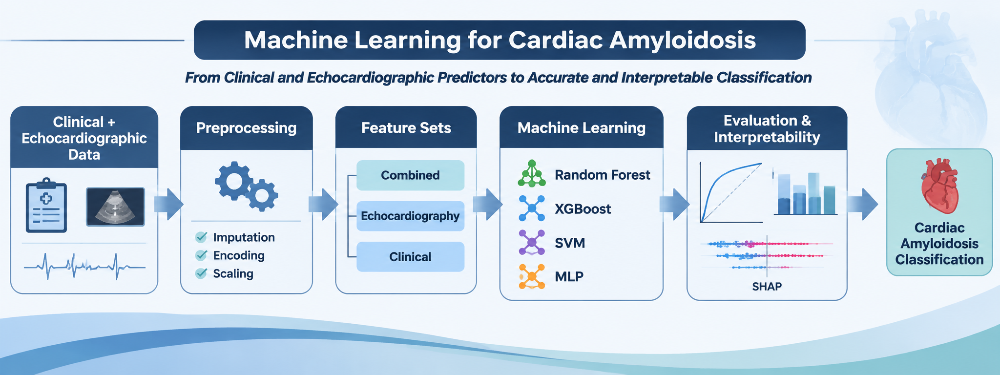
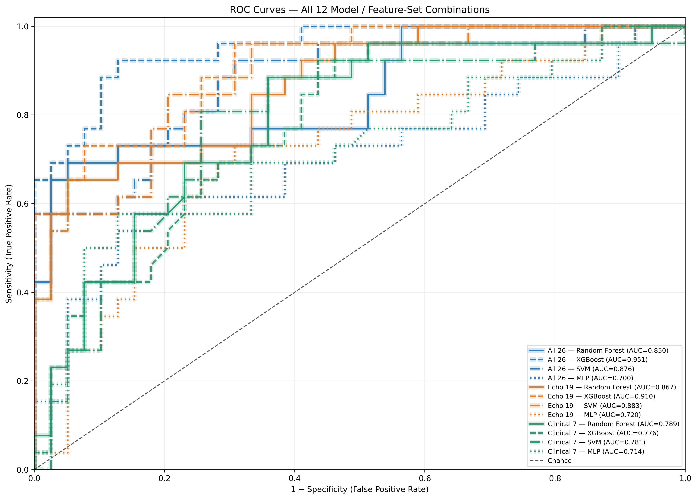
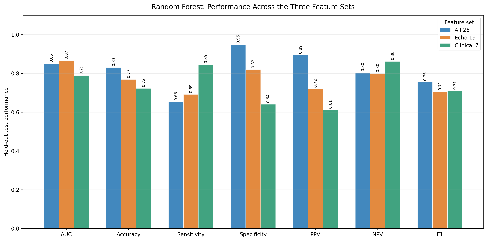
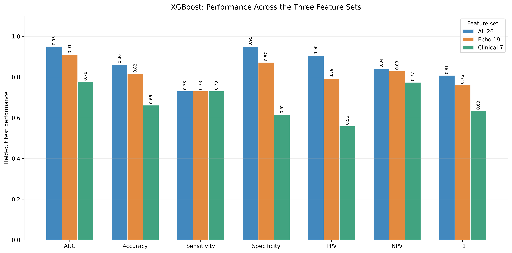
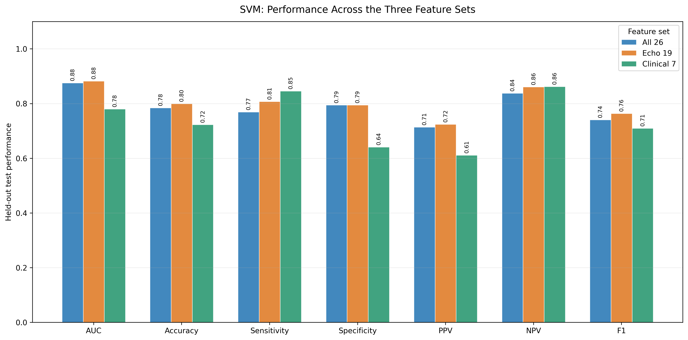
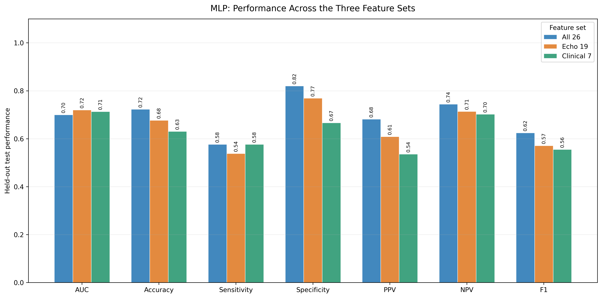
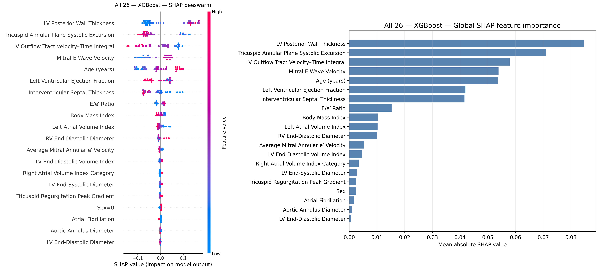
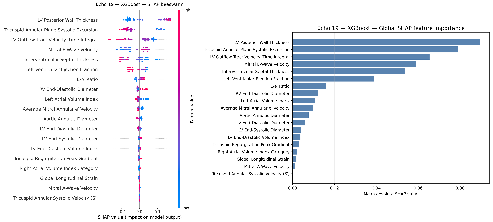

# Cardiac Amyloidosis Classification Using Clinical and Echocardiographic Predictors

<p align="center">
  
</p>

<p align="center">
  <strong>Clinical + echocardiographic predictors</strong> &nbsp;|&nbsp; <strong>4 classifiers</strong> &nbsp;|&nbsp; <strong>12 model configurations</strong> &nbsp;|&nbsp; <strong>SHAP-based interpretation</strong>
</p>

## Overview

This repository contains the Python analysis pipeline supplied for a machine-learning study of cardiac amyloidosis. The analysis evaluates whether clinical and echocardiographic predictors can distinguish patients with cardiac amyloidosis from controls. It compares three prespecified predictor sets—combined clinical and echocardiographic variables, echocardiographic variables alone, and clinical variables alone—using four classification algorithms.

The original analysis script is preserved **without modification**. Repository-level documentation and dependency files have been added to support execution outside Google Colab and publication on GitHub.

> **Research-use statement.** This repository describes a retrospective model-development and internal hold-out evaluation workflow. The reported results do not establish clinical utility, and the models are not intended for diagnosis, treatment decisions, or other direct clinical use.


## Key results at a glance

The supplied Results document reports the following principal findings:

| Study cohort | Held-out test set | Highest held-out AUC | Highest cross-validation AUC |
|---|---|---|---|
| **323 participants** (127 with cardiac amyloidosis; 196 controls) | **65 participants** (26 cases; 39 controls) | **0.951** — XGBoost, all 26 predictors | **0.925 ± 0.031** — SVM, all 26 predictors |

- **Best held-out configuration:** XGBoost using all 26 clinical and echocardiographic predictors achieved an AUC of **0.951** and accuracy of **0.862**. Sensitivity was **0.731**, specificity **0.949**, positive predictive value **0.905**, negative predictive value **0.841**, and F1 score **0.809**. The confusion matrix contained 37 true negatives, 2 false positives, 7 false negatives, and 19 true positives.
- **Cross-validation:** The highest mean five-fold cross-validation AUC was observed for the Combined SVM (**0.925 ± 0.031**); this differs from the highest held-out test AUC, which was observed for Combined XGBoost.
- **Model interpretation:** In Combined XGBoost, the five leading predictors by mean absolute SHAP value were left ventricular posterior wall thickness, tricuspid annular plane systolic excursion (TAPSE), left ventricular outflow tract velocity–time integral, mitral E-wave velocity, and age.

These are **internal evaluation results from the supplied analysis**, not external-validation estimates. Held-out metrics are point estimates; confidence intervals were not available in the supplied Results document.

## Figures from the Results document

The figures below are the original plots embedded in the supplied Results document. Select a figure to open its full-resolution PNG file.

### Figure 1. Receiver operating characteristic curves

ROC curves for all 12 combinations of classifier (Random Forest, XGBoost, SVM, and MLP) and predictor set (all 26 predictors, 19 echocardiographic predictors, or seven clinical predictors). AUC values refer to the held-out test set.

[](assets/figure-1-roc-curves-all-models.png)

### Figure 2. Held-out performance across predictor sets

The panels show AUC, accuracy, sensitivity, specificity, PPV, NPV, and F1 score for each classifier across the three predictor sets.

<p align="center">
  <a href="assets/figure-2a-random-forest-metrics.png"></a>
  <a href="assets/figure-2b-xgboost-metrics.png"></a>
</p>
<p align="center"><sub><strong>Figure 2A.</strong> Random Forest. &nbsp;&nbsp; <strong>Figure 2B.</strong> XGBoost.</sub></p>

<p align="center">
  <a href="assets/figure-2c-svm-metrics.png"></a>
  <a href="assets/figure-2d-mlp-metrics.png"></a>
</p>
<p align="center"><sub><strong>Figure 2C.</strong> SVM. &nbsp;&nbsp; <strong>Figure 2D.</strong> MLP.</sub></p>

### Figures 3 and 4. SHAP explanations for XGBoost

Each figure contains a SHAP beeswarm plot and a global mean absolute SHAP feature-importance plot. Figure 3 corresponds to the Combined model; Figure 4 corresponds to the Echocardiography-only model. One-hot encoded contributions are aggregated to their original predictors in the global importance summaries.

<p align="center">
  <a href="assets/figure-3-shap-xgboost-all-predictors.png"></a>
  <a href="assets/figure-4-shap-xgboost-echocardiographic-predictors.png"></a>
</p>
<p align="center"><sub><strong>Figure 3.</strong> Combined (26 predictors). &nbsp;&nbsp; <strong>Figure 4.</strong> Echocardiographic predictors only.</sub></p>

> SHAP values summarize model attribution and should not be interpreted as evidence of causality. Numerical magnitudes should not be compared directly across algorithms using different explainers or output scales.


## Study cohort and reported results

The supplied Results document reports a cohort of **323 participants**, comprising **127 patients with cardiac amyloidosis (39.3%)** and **196 controls (60.7%)**. A stratified 80:20 row-level split assigned 258 participants to the development set and 65 to the held-out test set (26 cases and 39 controls). Five-fold cross-validation was conducted within the development set.

### Baseline characteristics

Compared with controls, participants with cardiac amyloidosis were older (median [IQR], 62.0 [50.0–67.5] vs 50.0 [35.0–61.0] years; *p*<0.001) and had a lower body mass index (24.44 [21.64–27.39] vs 25.66 [23.38–28.70] kg/m²; *p*=0.006). Hypertension was less frequent in the cardiac amyloidosis group (21.3% vs 34.2%; *p*=0.013), whereas diabetes mellitus was more frequent (10.3% vs 4.1%; *p*=0.027). Recorded sex categories were similarly distributed between groups (*p*=0.809).

Several echocardiographic measures also differed between groups. Compared with controls, patients with cardiac amyloidosis had lower left ventricular ejection fraction (45.0 [35.0–52.5] vs 55.0 [47.5–55.0]; *p*<0.001), lower tricuspid annular plane systolic excursion (14.50 [12.00–18.00] vs 21.00 [18.00–23.00]; *p*<0.001), greater left ventricular posterior wall thickness (1.30 [1.10–1.50] vs 1.00 [0.88–1.20]; *p*<0.001), and a higher E/e′ ratio (17.91 [12.67–24.49] vs 10.83 [8.06–14.89]; *p*<0.001). Global longitudinal strain was less negative in the cardiac amyloidosis group (−10.50 [−13.55 to −8.00] vs −13.50 [−17.00 to −10.00]; *p*<0.001).

### Model development and cross-validation

The analysis evaluated **12 model–feature-set configurations** formed by combining three feature sets with four classifiers:

- **Feature sets:** Combined (26 predictors); Echocardiography (19 predictors); and Clinical (seven predictors).
- **Classifiers:** Random Forest, XGBoost, support vector machine (SVM; radial-basis-function kernel), and multilayer perceptron (MLP).

Hyperparameters were selected within the development set using three-fold stratified inner cross-validation and the one-standard-error rule. The selected parameters were then used for the five-fold cross-validation estimates and the final model evaluated on the held-out test subset.

The highest mean five-fold cross-validation AUC was observed for the **Combined SVM** (0.925 ± 0.031), followed by the **Echocardiography-only SVM** (0.906 ± 0.025) and the **Combined XGBoost model** (0.905 ± 0.021). The Combined SVM also had the highest mean cross-validation accuracy (0.860 ± 0.022).

| Feature set | Classifier | Cross-validation AUC, mean ± SD |
|---|---|---:|
| Combined | Random Forest | 0.882 ± 0.040 |
| Combined | XGBoost | 0.905 ± 0.021 |
| Combined | SVM | **0.925 ± 0.031** |
| Combined | MLP | 0.762 ± 0.089 |
| Echocardiography | Random Forest | 0.886 ± 0.041 |
| Echocardiography | XGBoost | 0.888 ± 0.023 |
| Echocardiography | SVM | 0.906 ± 0.025 |
| Echocardiography | MLP | 0.763 ± 0.062 |
| Clinical | Random Forest | 0.789 ± 0.043 |
| Clinical | XGBoost | 0.769 ± 0.061 |
| Clinical | SVM | 0.756 ± 0.045 |
| Clinical | MLP | 0.696 ± 0.101 |

### Held-out test performance

On the 65-participant held-out test subset, the **Combined XGBoost model** achieved the highest reported discrimination (AUC, 0.951) and accuracy (0.862). Its sensitivity was 0.731, specificity 0.949, positive predictive value 0.905, negative predictive value 0.841, and F1 score 0.809. Its confusion matrix comprised 37 true negatives, two false positives, seven false negatives, and 19 true positives.

The complete held-out performance results reported in the supplied Results document are reproduced below.

| Feature set | Classifier | AUC | Accuracy | Sensitivity | Specificity | PPV | NPV | F1 |
|---|---|---:|---:|---:|---:|---:|---:|---:|
| Combined | Random Forest | 0.850 | 0.831 | 0.654 | 0.949 | 0.895 | 0.804 | 0.756 |
| Combined | XGBoost | **0.951** | **0.862** | 0.731 | 0.949 | **0.905** | 0.841 | **0.809** |
| Combined | SVM | 0.876 | 0.785 | 0.769 | 0.795 | 0.714 | 0.838 | 0.741 |
| Combined | MLP | 0.700 | 0.723 | 0.577 | 0.821 | 0.682 | 0.744 | 0.625 |
| Echocardiography | Random Forest | 0.867 | 0.769 | 0.692 | 0.821 | 0.720 | 0.800 | 0.706 |
| Echocardiography | XGBoost | 0.910 | 0.815 | 0.731 | 0.872 | 0.792 | 0.829 | 0.760 |
| Echocardiography | SVM | 0.883 | 0.800 | **0.808** | 0.795 | 0.724 | **0.861** | 0.764 |
| Echocardiography | MLP | 0.720 | 0.677 | 0.538 | 0.769 | 0.609 | 0.714 | 0.571 |
| Clinical | Random Forest | 0.789 | 0.723 | 0.846 | 0.641 | 0.611 | 0.862 | 0.710 |
| Clinical | XGBoost | 0.776 | 0.662 | 0.731 | 0.615 | 0.559 | 0.774 | 0.633 |
| Clinical | SVM | 0.781 | 0.723 | 0.846 | 0.641 | 0.611 | 0.862 | 0.710 |
| Clinical | MLP | 0.714 | 0.631 | 0.577 | 0.667 | 0.536 | 0.703 | 0.556 |

PPV, positive predictive value; NPV, negative predictive value. Test-set metrics are point estimates; confidence intervals were not available in the supplied analysis. The 20% test subset is an internal hold-out from the same cohort and should not be described as external validation.

The relative contribution of feature sets varied by classifier. XGBoost performed best with the Combined feature set, whereas Random Forest, SVM, and MLP each had a higher test AUC with echocardiographic predictors alone than with the combined feature set. Clinical-only models generally showed lower discrimination; the Clinical-only Random Forest and SVM had sensitivity of 0.846 and specificity of 0.641.

### SHAP-based model interpretation

SHAP explanations were generated for all 12 fitted models using held-out test observations and background observations sampled from the development data. TreeSHAP was used for Random Forest and XGBoost; PermutationSHAP was used for SVM and MLP. One-hot encoded contributions were aggregated to their corresponding original predictors for global feature-importance summaries.

For the Combined XGBoost model, the five highest-ranked predictors by mean absolute SHAP value were left ventricular posterior wall thickness (0.0848), tricuspid annular plane systolic excursion (0.0710), left ventricular outflow tract velocity–time integral (0.0579), mitral E-wave velocity (0.0539), and age (0.0536). For Echocardiography-only XGBoost, the leading predictors were left ventricular posterior wall thickness (0.0896), tricuspid annular plane systolic excursion (0.0791), left ventricular outflow tract velocity–time integral (0.0655), mitral E-wave velocity (0.0590), and interventricular septal thickness (0.0535).

Feature rankings differed across algorithms. Measures of ventricular wall thickness and longitudinal function repeatedly appeared among influential predictors. Mean absolute SHAP values describe model attribution and do not establish causal relationships. Numerical magnitudes should not be compared directly across algorithms using different explainers or output scales.

## Analytical workflow

The supplied script performs the following operations:

1. Reads the Excel workbook and validates the binary target and expected predictor counts.
2. Identifies the clinical/echocardiographic boundary from the column beginning with `LV End-Diastolic Diameter`; predictor column order is therefore material.
3. Generates cohort and baseline-characteristic summaries.
4. Creates a stratified development/test partition and cross-validation splits.
5. Fits and evaluates the 12 model–feature-set configurations.
6. Exports model metrics, confusion matrices, predictions, fitted models, and a run manifest.
7. Generates a combined ROC plot and model-specific metric-comparison plots.
8. Generates SHAP explanations and feature-importance summaries when SHAP execution is successful.
9. Writes a ZIP archive of the results directory.

The original preprocessing sequence and analysis settings are retained in the Python file. These include median imputation for numerical variables; constant imputation and ordinal encoding for categorical variables; one-hot encoding; and standardization of the processed feature matrix. The script does not apply feature selection, LASSO, stepwise selection, SMOTE, or PCA. It does not perform nested cross-validation, Harrell bootstrap confidence-interval estimation, or a separate overfitting analysis.

## Input data

The individual-level study workbook is **not included** in this repository. Before running the analysis, place the authorized Excel workbook in the repository root and name it:

```text
final_data.xlsx
```

The script's default non-Colab data path is `final_data.xlsx` in the current working directory. In Google Colab, it uses `/content/final_data.xlsx` and retains the existing upload prompt if the file is not found.

The workbook must satisfy the checks implemented in the script:

- Include a target column named `amyloidosis`, coded `0` for controls and `1` for cardiac amyloidosis.
- Include exactly 26 model predictors after the target, any detected patient/group identifier, and any configured exclusions are removed.
- Include exactly one predictor column whose name begins with `LV End-Diastolic Diameter`. This column marks the start of the 19 echocardiographic predictors.
- Preserve the intended column ordering: the seven clinical predictors occur before the echocardiographic boundary, and the 19 echocardiographic predictors begin at that boundary.
- Use unique column names and retain the variable names expected by the analysis configuration.

Do not commit identifiable, confidential, or otherwise restricted participant-level data to a public repository. Confirm data-use permissions and institutional requirements before sharing any data or derived artifacts.

## Installation and execution

The pipeline is a standalone Python script exported from the supplied Colab workflow. It can be run locally or in Google Colab.

### 1. Clone the repository

```bash
git clone https://github.com/<YOUR-USERNAME>/<YOUR-REPOSITORY>.git
cd <YOUR-REPOSITORY>
```

### 2. Create an environment and install dependencies

Python 3.10 or later is recommended.

```bash
python -m venv .venv
```

Activate the environment:

```bash
# macOS / Linux
source .venv/bin/activate

# Windows PowerShell
.venv\Scripts\Activate.ps1
```

Install the dependencies:

```bash
python -m pip install --upgrade pip
python -m pip install -r requirements.txt
```

### 3. Add the input workbook

Copy the authorized study workbook to the repository root as `final_data.xlsx`. The `.gitignore` file excludes this default input filename and the generated results directory from version control.

### 4. Run the pipeline

```bash
python amyloidosis_colab_pipeline.py
```

The default output directory is `ML_results/` beneath the current working directory. The script also creates `ML_results.zip` when the configured results-archive option is enabled. In Google Colab, the existing automatic ZIP download behavior is retained.

### Main output structure

The pipeline creates the following outputs (individual files may depend on which analyses complete successfully):

```text
ML_results/
├── analysis_manifest.json
├── README_results.txt
├── demographic analysis.xlsx
├── model_performance_summary.xlsx
├── fitted_models/
├── plots/
│   ├── ROC_AUC_all_12_models.png
│   └── metric_comparisons/
├── predictions/
│   └── heldout_test_predictions.csv
├── SHAP/
└── tables/
    ├── model_performance_summary.csv
    ├── model_performance_numeric.csv
    ├── cross_validation_fold_metrics.csv
    ├── heldout_confusion_matrix_counts.csv
    └── selected_hyperparameters.csv
```

The `analysis_manifest.json` file records the feature sets, model configurations, preprocessing, splitting, tuning, metrics, and SHAP settings used for a particular run.

## Data availability

The patient-level dataset used in this study cannot be made publicly available because it contains confidential health information and is subject to institutional, ethical, and privacy restrictions. No patient-level records, direct identifiers, or row-level predictions are distributed with this repository. The repository provides the analysis code and aggregate results/figures only. Investigators requiring access to the underlying data must seek permission from the responsible institution and comply with the applicable ethics approval, data-use agreements, and local regulations.

The expected input workbook (`final_data.xlsx`) must therefore be obtained independently through an authorized route. **Please do not upload the study workbook or any identifiable or restricted patient-level derivatives to this public repository.**

## Limitations

Several limitations should be considered when interpreting these findings:

- **Class distribution:** The cohort included 127 participants with cardiac amyloidosis (39.3%) and 196 controls (60.7%). This represents a moderate class imbalance. Although the split was stratified, differences in class prevalence can influence threshold-dependent measures, particularly PPV and NPV, and performance may change in populations with a different prevalence. No SMOTE or other synthetic oversampling method was applied.
- **Sample size and events per predictor:** There were 127 amyloidosis cases for 26 original predictors, corresponding to a crude ratio of approximately 4.9 cases per original predictor. This is not a formal events-per-variable assessment for these machine-learning algorithms; categorical encoding can also expand the effective number of model inputs. Nevertheless, the cohort is modest relative to the number of candidate predictors and model configurations, creating a risk of unstable estimates and limited generalizability.
- **Internal validation only:** The 20% hold-out was drawn from the same cohort and is an internal test subset, not external validation. The reported test metrics are point estimates without confidence intervals.
- **No nested cross-validation or optimism correction:** Hyperparameters were selected using three-fold stratified inner cross-validation within the development set and the one-standard-error rule. The supplied Results document does not report nested cross-validation, bootstrap confidence intervals, or a separate optimism-correction analysis.
- **Potential row-level dependence:** The Results document describes a stratified row-level split, not a group-aware split. If multiple records from the same participant or related observations are present, this may lead to dependence between development and test subsets.
- **Missing data:** Several variables had appreciable missingness (for example, left atrial volume index: 20.7%; mitral A-wave velocity: 16.1%; and left ventricular outflow tract velocity–time integral: 13.6%). Missing values were imputed within the model-preprocessing workflow, but imputation cannot fully remove uncertainty associated with missing data.
- **Predictor coding and baseline-test discrepancies:** The author checks in the supplied Results document identify differences between the stated predictor coding/statistical tests and the supplied script. These should be reconciled against the study data dictionary and final analysis manifest before claiming exact computational reproducibility. The original script is intentionally preserved unchanged.
- **No clinical utility assessment:** The study is a model-development and internal evaluation exercise. Prospective evaluation, external validation, calibration assessment, and clinical impact studies are required before any clinical application.

## Model interpretability

Interpretability was assessed for all 12 fitted model/feature-set configurations using held-out test observations and background observations sampled from the development data. **TreeSHAP** was used for Random Forest and XGBoost, while **PermutationSHAP** was used for SVM and MLP. For SVM, the explained output is the amyloidosis-oriented decision margin; for MLP, it is the predicted probability of the positive class. Contributions from one-hot encoded variables were aggregated to their corresponding original predictors for global feature-importance summaries.

For the Combined XGBoost model, the highest mean absolute SHAP values were observed for left ventricular posterior wall thickness (0.0848), tricuspid annular plane systolic excursion (TAPSE; 0.0710), left ventricular outflow tract velocity–time integral (0.0579), mitral E-wave velocity (0.0539), and age (0.0536). In the Echocardiography XGBoost model, the leading predictors were left ventricular posterior wall thickness (0.0896), TAPSE (0.0791), left ventricular outflow tract velocity–time integral (0.0655), mitral E-wave velocity (0.0590), and interventricular septal thickness (0.0535).

The leading predictors varied by classifier. For the Combined models, the top five for Random Forest were TAPSE, left ventricular outflow tract velocity–time integral, left ventricular ejection fraction, left ventricular posterior wall thickness, and E/e′ ratio. For SVM, they were left ventricular posterior wall thickness, age, TAPSE, left ventricular outflow tract velocity–time integral, and hypertension. For MLP, they were mitral E-wave velocity, hypertension, right atrial volume index category, mitral A-wave velocity, and tricuspid annular systolic velocity.

These explanations describe how fitted models use the available predictors; they do not establish causality, biological mechanisms, or independent clinical effects. Rankings are most appropriately interpreted within each model. SHAP magnitudes should not be compared directly across algorithms that use different explainers or output scales.

## Reproducibility notes

The supplied Results document includes author checks that should be reviewed before the code and manuscript are represented as a single, fully aligned analysis:

- **Predictor coding:** The Results document's author checks state that only Sex and Hypertension were categorical in the reported analysis, while the supplied script's `CATEGORICAL_VARIABLES` list also includes Age, Diabetes mellitus, Coronary artery disease, Atrial fibrillation, LV dias, LVH, LAViCat, RAViCat, AI, MR, TR, and PI. Age is additionally subject to the script's automatic numeric/categorical rule. Verify coding against the study data dictionary.
- **Baseline statistical tests:** The Results document describes Mann–Whitney U tests for continuous variables and Pearson chi-square tests for categorical variables. The supplied script instead uses a Shapiro–Wilk-guided choice between Welch's t-test and Mann–Whitney U, and can use Fisher's exact test for sparse 2×2 tables.
- **Splitting strategy:** The Results document reports a stratified row-level split. The script can automatically detect common patient/group identifier columns and use group-aware splitting if repeated identifiers are found; actual behavior depends on the workbook.
- **SVM scoring:** ROC-AUC is calculated from the amyloidosis-oriented decision function, while classification metrics are based on `SVC.predict()`. Probability estimates are not the basis of the reported SVM class predictions.

The Python pipeline and its analysis settings have not been modified as part of this repository documentation update.

## Citation

If you use this code, please cite the repository and the associated manuscript when available. The Zenodo DOI is intentionally left as a placeholder until the repository is archived:

> Haghani A, et al. *Cardiac amyloidosis classification using clinical and echocardiographic predictors*. [Software]. Zenodo. DOI: `10.5281/zenodo.XXXXXXX` (replace with the minted DOI).

A machine-readable citation template is provided in [`CITATION.cff`](CITATION.cff). Replace the placeholder DOI and author metadata with the final bibliographic information after Zenodo publication.

## License

This project is distributed under the MIT License. See [`LICENSE`](LICENSE) for the full license text. Before public release, the project authors should confirm that they hold the rights to license and redistribute the source code under these terms. The MIT License applies to the repository code; it does not grant access to the restricted patient-level dataset.
